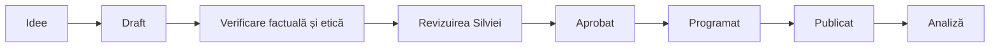

# Măsurare, aprobare și moderare social media

## Flux editorial

## Stări

| Stare | Semnificație |
| --- | --- |
| `draft` | material în lucru; nu se publică |
| `in-review` | trimis Silviei sau unui revizor competent |
| `approved` | textul și vizualul sunt aprobate pentru canalul și data indicate |
| `published` | publicat; se notează URL-ul și data |
| `archived` | retras, depășit sau înlocuit |

Schimbarea textului după aprobare readuce materialul în `in-review`.

## Checklist înainte de publicare

### Acuratețe

- [ ] Nu inventează fapte despre Silvia, formare, experiență, servicii sau disponibilitate.
- [ ] Titlul profesional este cel confirmat.
- [ ] Orice afirmație despre adolescenți 16–17 ani a fost verificată.
- [ ] Nu prezintă o ipoteză psihologică drept adevăr universal.
- [ ] Nu reduce un simptom fizic la o cauză psihologică și nu descurajează evaluarea medicală.

### Etică și ton

- [ ] Nu diagnostichează cititorul.
- [ ] Nu afirmă sau sugerează că privitorul are o condiție psihică.
- [ ] Nu promite rezultate și nu folosește superioritate.
- [ ] Nu folosește frică, rușine, urgență sau presiune.
- [ ] Nu conține cazuri reale, chiar dacă numele ar fi schimbat.
- [ ] Nu cere comentarii sau mesaje cu informații sensibile.
- [ ] Folosește `dumneavoastră`, exceptând o decizie editorială explicită pentru adolescenți.

### Claritate

- [ ] Are o singură idee principală.
- [ ] Diacriticele sunt corecte.
- [ ] Termenii profesionali sunt explicați.
- [ ] CTA-ul este opțional și proporțional cu materialul.
- [ ] Textul poate fi înțeles fără contextul altor postări.

### Vizual și accesibilitate

- [ ] Contrastul este suficient.
- [ ] Textul este lizibil pe telefon.
- [ ] Elementele importante nu sunt acoperite de interfața platformei.
- [ ] Videoclipul are subtitrări.
- [ ] Imaginea are text alternativ când platforma permite.
- [ ] Nu apare adresa exactă a cabinetului.

### Confidențialitate și operare

- [ ] Linkul trimite doar către o pagină aprobată.
- [ ] Nu se colectează date sensibile prin formular social.
- [ ] Orice parametru UTM este generic și nu codifică o categorie de sănătate a persoanei.
- [ ] Instrumentul de publicare folosit are accesul minim necesar.

## Moderarea comentariilor

### Se poate răspunde public

- întrebărilor generale despre servicii;
- întrebărilor despre ședințe online sau în persoană;
- solicitărilor de link sau adresă de email;
- comentariilor despre tema postării care nu conțin informații sensibile.

### Nu se răspunde clinic

Nu se oferă interpretări, diagnostic, recomandări individualizate sau evaluări în comentarii și mesaje directe.

### Comentarii cu informații personale

1. Nu se dezvoltă conversația în public.
2. Se răspunde scurt, fără repetarea detaliilor persoanei.
3. Se indică faptul că social media nu este un cadru potrivit pentru discutarea informațiilor sensibile.
4. Dacă este potrivit, persoana este trimisă către datele generale de contact.
5. Se ascunde sau se elimină comentariul dacă păstrarea lui expune persoana ori încalcă regulile comunității.

### Situații de criză

Social media nu trebuie prezentată ca serviciu de urgență. Înainte de lansare este necesar un protocol separat, aprobat profesional, care include:

- formulare de răspuns;
- resurse de urgență actuale pentru România;
- criterii de ascundere sau raportare;
- limitele rolului Silviei și ale persoanei care administrează contul.

Nu se improvizează public un răspuns într-o situație de risc.

## Mesaje directe

### Principiu

DM-ul este canal administrativ, nu spațiu pentru evaluare sau terapie.

### Răspuns standard — draft

> Vă mulțumesc pentru mesaj. Pentru a proteja confidențialitatea, nu discut situații personale prin social media. Pentru informații despre ședințe și disponibilitate, puteți scrie la adresa de email din profil.

Formularea trebuie aprobată de Silvia și adaptată realității operaționale.

### Nu se solicită în DM

- descrierea simptomelor;
- istoricul psihologic sau medical;
- informații despre tratament;
- date despre un minor;
- fotografii de documente;
- detalii despre situații de urgență.

## Măsurare

### Săptămânal

| Indicator | De ce contează |
| --- | --- |
| acoperire per format | arată capacitatea de descoperire |
| salvări | semnal pentru utilitate și revenire |
| distribuiri | semnal pentru relevanță interpersonală |
| vizite pe profil | interes pentru identitatea profesională |
| accesări ale linkului | trecere către informații mai complete |
| comentarii de calitate | întrebări generale, fără autoexpunere sensibilă |
| timp de vizionare Reel | potrivirea ritmului și a subiectului |

### Lunar

- teme cu cele mai multe salvări și distribuiri;
- performanță pe format;
- evoluția vizitelor pe profil și a accesărilor website-ului;
- contacte care declară voluntar că au găsit-o pe Silvia prin social media;
- timp de producție per material;
- incidente de moderare sau formulări care au necesitat corecție.

### Ce nu optimizăm

- comentarii obținute prin întrebări intime;
- urmăritori cumpărați;
- vizualizări fără legătură cu publicul și serviciile;
- frecvență care reduce calitatea;
- cost per lead bazat pe formulare care colectează informații sensibile.

## Raport de final al pilotului

La sfârșitul celor șase săptămâni, raportul trebuie să răspundă:

1. Ce teme au oferit cea mai mare valoare măsurată prin salvări și distribuiri?
2. Ce formate sunt sustenabile pentru Silvia?
3. Ce postări au trimis publicul către website?
4. Ce întrebări generale au apărut repetat?
5. Au existat riscuri de confidențialitate sau moderare?
6. Este justificată publicitatea plătită?
7. Ce materiale pot deveni articole de blog sau conținut evergreen?

## Separarea fișierelor canonice

- strategia și cercetarea rămân în acest vault;
- materialele gata de execuție se mută în `campaigns/`;
- vizualurile aprobate se păstrează în `brand-assets/`;
- procedurile operaționale finale se mută în `operations/`;
- nota din vault păstrează legătura către locația canonică și starea materialului.

