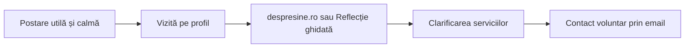

# Plan campanie social media V1

> [!warning] Necesită revizuirea Silviei
> Strategia este pregătită pentru lucru, nu pentru publicare automată. Titlurile profesionale, descrierea serviciilor, formulările despre adolescenți 16–17 ani, confidențialitate și orice afirmație profesională trebuie confirmate înainte de publicare.

## Rezumat

**Concept de lucru:** `Spațiu pentru ceea ce cere atenție`

**Durată:** pilot de 6 săptămâni, după pregătirea profilului și a paginii de contact.

**Canal principal:** Instagram.

**Canal secundar:** Facebook, prin adaptarea și publicarea nativă a conținutului relevant.

**Publicitate plătită:** opțională, numai după minimum două săptămâni de conținut organic și după documentarea implicațiilor de confidențialitate.

**Destinație principală:** `https://despresine.ro`, după activarea DNS și aprobarea conținutului public.

**Ideea centrală:** pagina Silviei oferă explicații clare și nuanțate despre viața interioară și procesul psihoterapeutic, fără diagnosticare, promisiuni sau presiune comercială.

## Obiectiv

### Obiectiv principal

Construirea unei prezențe profesionale recognoscibile și demne de încredere pentru persoane care iau în considerare psihoterapia sau consilierea.

### Obiective secundare

- clarificarea modului în care poate fi înțeles un demers psihoterapeutic;
- familiarizarea publicului cu stilul profesional și orientarea Silviei;
- trimiterea discretă către website, `Reflecție ghidată` și contact prin email;
- generarea unei baze de conținut editorial care poate alimenta ulterior blogul și campaniile plătite.

### Ce nu urmărește V1

- creștere rapidă cu orice preț;
- viralitate prin conținut senzaționalist;
- conversații clinice în comentarii sau mesaje directe;
- autodiagnosticare;
- colectarea de informații despre sănătatea psihică prin platformele sociale;
- poziționarea Silviei ca influencer de lifestyle.

## Publicuri prioritare

1. **Adulți și tineri adulți care se gândesc pentru prima dată la psihoterapie**
   - au nevoie de claritate, limbaj firesc și reducerea incertitudinii despre proces;
   - nu trebuie presupus că au un diagnostic sau o anumită problemă.

2. **Persoane care au mai avut contact cu psihoterapia**
   - pot căuta o orientare psihanalitică sau psihodinamică și un cadru profesionist;
   - mesajele trebuie să descrie abordarea fără comparații de superioritate.

3. **Persoane interesate de ședințe online**
   - pot locui oriunde în România;
   - formatul online și cel în persoană primesc vizibilitate egală.

4. **Părinți sau reprezentanți legali ai adolescenților de 16–17 ani**
   - conținutul trebuie să explice cu atenție rolul consimțământului;
   - orice formulare juridică sau profesională necesită verificare înainte de publicare.

> [!note] Decizie pentru publicitatea plătită
> Pilotul plătit va viza numai persoane de 18 ani și peste. Conținutul organic poate aborda adolescența 16+, dar fără solicitarea sau discutarea publică a experiențelor personale ale minorilor.

## Poziționare

Silvia este prezentată ca un profesionist calm, atent și riguros, care creează spațiu pentru înțelegere. Comunicarea nu promite schimbări rapide și nu transformă dificultatea umană într-un set de „simptome de bifat”.

### Promisiunea editorială

> Aici găsiți texte care pot ajuta la formularea unor întrebări și la înțelegerea mai atentă a ceea ce trăiți. Ele nu oferă diagnostice și nu înlocuiesc o evaluare psihologică profesională.

Această formulare este un draft și trebuie revizuită înainte de folosire publică.

## Rolul platformelor

| Platformă | Rol în V1 | Ritm recomandat | Observație |
| --- | --- | --- | --- |
| Instagram | casă editorială și identitate vizuală | 3 postări pe săptămână; Stories în 2–3 zile | carusele, texte editoriale, fotografii rare, Reel simplu |
| Facebook | distribuție locală și acces la un public mai larg | 2–3 postări pe săptămână | textele se adaptează și se publică nativ; fără copiere mecanică |
| TikTok | în afara V1 | fără ritm | audiență mare, dar cerințele de producție și convențiile platformei nu se potrivesc încă direcției |
| LinkedIn | canal complementar pentru contextul profesional | 2 postări pe săptămână | profil personal, exclusiv text; detalii în [[plan-linkedin-v1]] |

Raționamentul și datele sunt în [[piata-romania-si-reguli-platforme-2026]].

> [!note] Actualizare 2026-07-02
> Rolul LinkedIn a fost promovat de la „experiment ulterior" la canal complementar, prin decizia `2026-07-02-extindere-linkedin`. Planul de față rămâne valabil pentru Instagram și Facebook; extinderea LinkedIn este descrisă în [[plan-linkedin-v1]].

## Structura pilotului

| Etapă | Săptămâni | Scop |
| --- | --- | --- |
| Introducere | 1 | identitate, ton, servicii, modalități de lucru |
| Familiarizare | 2–3 | teme de lucru și clarificarea procesului |
| Aprofundare | 4–5 | relații, identitate, tranziții, adolescență 16+ |
| Integrare | 6 | recapitulare, Reflecție ghidată, contact discret |

Planul concret este în [[calendar-editorial-pilot-6-saptamani]].

## Ritm editorial

### Feed

- **Luni:** carusel educațional sau de reflecție;
- **Miercuri:** postare editorială scurtă, fotografie profesională sau Reel simplu;
- **Vineri:** clarificare despre proces, relații ori o invitație discretă către o resursă.

### Stories

- 2–3 zile pe săptămână;
- 1–3 cadre într-o zi, nu serii lungi;
- fragmente din postarea săptămânii, recomandări de lectură, detalii despre activitatea profesională sau anunțuri;
- fără întrebări care cer dezvăluirea publică a unei dificultăți psihologice;
- fără sondaje de tip „Aveți anxietate?” sau „Vă regăsiți în aceste simptome?”.

## Direcție creativă

- alb-negru, editorial, cu mult spațiu liber;
- tipografia este elementul vizual principal;
- una sau două fotografii profesionale în întregul set inițial;
- fără fotografii stock cu ședințe de terapie, mâini împreunate, siluete triste sau natură folosită ca metaforă generică;
- Reels filmate simplu, cu cadru stabil, lumină naturală și subtitrări;
- fără audio în trend dacă nu susține tonul și sensul materialului;
- fără tranziții rapide, decor emoțional excesiv sau text aglomerat.

Detaliile de voce, formate și CTA-uri sunt în [[sistem-editorial-social-media]].

## Parcursul dorit

Fiecare etapă trebuie să poată exista fără urmărirea comportamentală a persoanei.

## Pilot plătit opțional

Pilotul plătit începe numai dacă:

- profilul are minimum 6–9 postări publicate;
- `https://despresine.ro` este activ, iar pagina de contact funcționează;
- formulările profesionale sunt aprobate;
- există o notă de confidențialitate pentru instrumentele Meta folosite;
- materialele organice indică deja ce teme generează interes de calitate.

### Structură recomandată

1. **Campanie de notorietate locală**
   - București;
   - 18+;
   - mesaj despre serviciile în persoană și online;
   - audiență relativ largă, fără presupuneri despre sănătatea psihică.

2. **Campanie de trafic către website**
   - România;
   - 18+;
   - accent pe informații și ședințe online;
   - fără formular Meta care solicită informații despre starea psihică.

3. **Materiale**
   - se folosesc numai postări organice validate prin calitatea reacțiilor;
   - textele nu afirmă sau sugerează că privitorul are anxietate, depresie ori altă condiție;
   - nu se folosesc înainte/după, mărturii ale clienților sau rezultate promise.

Bugetul se decide separat, după stabilirea obiectivului și a capacității de preluare a solicitărilor.

## Criterii de succes

### Semnale principale

- salvări și distribuiri ale materialelor educaționale;
- vizite pe profil;
- accesări ale website-ului din profil;
- contacte prin email care menționează social media ca sursă;
- consecvența publicării și respectarea procesului de aprobare.

### Semnale secundare

- urmăritori relevanți;
- comentarii cu întrebări generale și respectuoase;
- retenția Reel-urilor;
- performanța comparativă a caruselelor, postărilor statice și Reel-urilor.

Nu se vor folosi benchmarkuri generice ca obiective. Primele șase săptămâni stabilesc baza proprie de comparație. Procesul este în [[masurare-aprobare-si-moderare-social-media]].

## Condiții înainte de lansare

- [ ] Silvia confirmă titlurile profesionale și formularea serviciilor.
- [ ] Silvia aprobă descrierea orientării psihanalitice sau psihodinamice.
- [ ] Se aprobă formularea pentru adolescenți 16–17 ani.
- [ ] Se aprobă bio-ul, fotografia de profil și maximum două fotografii profesionale.
- [ ] `https://despresine.ro` este activ și are o pagină clară de contact.
- [ ] Politica de confidențialitate este publicată și revizuită.
- [ ] Este pregătit un răspuns standard pentru mesaje directe.
- [ ] Este pregătită o procedură pentru comentarii sensibile sau situații de criză.
- [ ] Sunt definite persoana care redactează, persoana care aprobă și data publicării.
- [ ] Orice instrument de programare este evaluat din perspectiva accesului la cont și a confidențialității.

## Legături

- [[piata-romania-si-reguli-platforme-2026]]
- [[sistem-editorial-social-media]]
- [[calendar-editorial-pilot-6-saptamani]]
- [[masurare-aprobare-si-moderare-social-media]]
